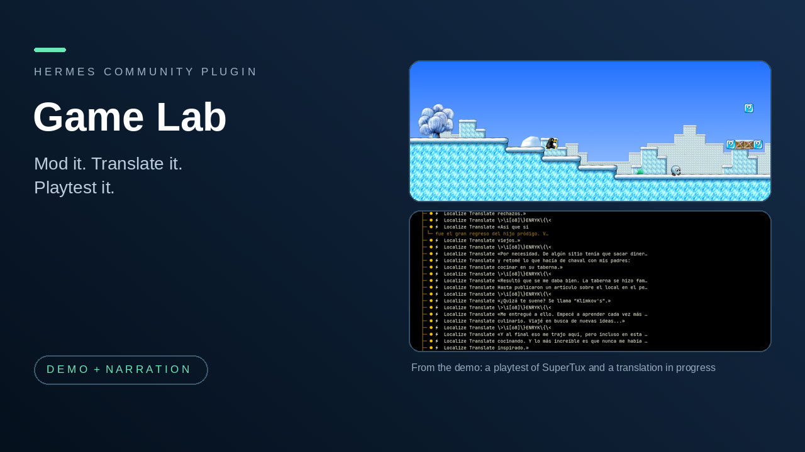

# Game Lab

Work on games with Hermes: mod a game on a safe copy, translate its text without breaking it, check character sprite sheets, and playtest it by pressing and holding keys and reporting honestly.

**New in 0.2.2:** `playtest_run` executes a checklist under one approval and returns a measured report. Playtest remains experimental: direct batch tests produced 0/4 complete correct SuperTux runs and 0/2 Packet Storm runs; no 0.2.2 Hermes sessions qualified or were attempted because the direct-test gate was not met. See VERIFICATION.md for limitations.

**New in 0.2.1:** Playtest Pilot adds an approved, single-call capture/input/measurement check and a magnified HUD crop. This part is experimental: 0/7 new SuperTux attempts and 0/5 Packet Storm attempts produced a complete correct report. See VERIFICATION.md for the causes and limits.

**New in 0.2.0:** a fourth part, Sprites, checks RPG Maker MV character sheets (and ModLab now tells you, before a mod is applied, if a character PNG in it does not fit the grid). After a mod is applied in a lab copy, or a translation is exported, Hermes now says plainly that the game can be playtested and offers it: you ask "Playtest it: ...". Nothing is started for you.

**Why one plugin:** mod it, translate it, check its sprites, then playtest it. Those are steps of the same job, so they live together.

**Who it is for:** someone who owns a PC game and wants Hermes to help change it, translate it and check that it still plays, without risking the original install.

## The four parts

| Part | What it is for | Tools |
|---|---|---|
| ModLab | Copy a game folder into a lab, apply mod ZIPs as revisions you can inspect and roll back, and drive Universal Modder and Reverse Engineer Anything for recon, assets, builds and tests. The original folder is only read. | `modlab_resources`, `modlab_toolkit`, `modlab_rea_native`, `modlab_create`, `modlab_inspect`, `modlab_apply`, `modlab_rollback`, `modlab_select_preserved` |
| Game Localization Studio | Make translation drafts for RPG Maker MV/MZ message text. Every line is addressed to its source, control codes and row widths are checked, and the result is exported as a new file. | `localize_inspect`, `localize_get`, `localize_translate`, `localize_validate`, `localize_export`, `localize_list_drafts` |
| Playtest Pilot (experimental) | Run an approved checklist and report measured verdicts, or explore a single input and record an observation. | `playtest_run`, `playtest_start`, `playtest_check`, `playtest_read_value`, `playtest_action`, `playtest_replay`, `playtest_observe`, `playtest_report` |
| Sprites | Inspect an RPG Maker MV character sheet PNG (single-character `$` sheet or the ordinary eight-character sheet): grid, frame size, empty cells, alpha bounds. Preview one walk row as a separate animated GIF. Pairs with ModLab: before a mod that replaces character art is applied, check the sheet. Needs Pillow. | `sprite_inspect_mv`, `sprite_preview_mv` |

24 tools, one hook (`pre_tool_call`, which asks for approval before each batch, atomic check and legacy held key), four skills (`modlab`, `game-localization-studio`, `playtest-pilot`, `sprite-contract`) and one Desktop page for the translation drafts.

ModLab and Game Localization Studio are also published on their own. Playtest Pilot began from the stand-alone 0.3.0 plugin and now has bundle-specific atomic tools and approval handling. Sprites is the stand-alone Sprite Contract 0.1.0 plugin. The bundle also connects the parts through two text hints:

- `modlab_inspect` adds a `sprite_check` note for PNGs under `img/characters/` or `img/sv_actors/` in the mod ZIP: does the sheet divide evenly into the MV grid for its filename. It only reports; it never blocks the mod.
- `modlab_apply` and `localize_export` add a `playtest` line: the result is ready to be playtested, and how to ask ("Playtest it: ..."). The ModLab and localization skills tell Hermes to offer it. No game or playtest is ever started automatically.

**At a glance**

- **Install:** `hermes plugins install flabanabba8/game-lab`, then `hermes plugins enable game-lab`.
- **Needs:** Hermes 0.22 or later and a game you own or may translate.
  - Sprites and atomic playtest captures need Pillow (declared in the manifest, installed with `--install-deps`).
  - ModLab also needs the companion tools Universal Modder (`um`) and Reverse Engineer Anything (`rea`), installed by you, for the steps that use them. Its optional setting `rea_native_tool` names a native REA tool already registered in your Hermes.
  - Game Localization Studio needs RPG Maker MV/MZ JSON data files. Hermes itself does the translating; no key or model is required by the plugin.
  - Playtest Pilot needs a model and provider that accept images in tool results, a Linux X11 (or XWayland) display, `xdotool` and Pillow with X11 capture support; optional `tesseract` reads potential panel text. Hermes `computer_use` can list windows and remains necessary for legacy actions. The legacy scene hint optionally uses NumPy.
- **Platform:** Linux is the only platform checked.
- **Internet:** the plugin makes no network calls of its own: no telemetry, update checks or model calls. Any network use comes from the companion tools you choose to run with ModLab.
- **Keys and accounts:** none read or stored.
- **Approvals:** each atomic check and each legacy hold asks through this plugin’s approval box; other legacy actions use the Hermes `computer_use` approval policy.

## Where things are stored

Each part keeps its data in its own Hermes plugin-data folder, so nothing is shared between them: `game-lab-modlab` (labs, revisions, toolkit logs), `game-lab-localization` (copies of the source file, drafts and exports) and `game-lab-playtest` (playtest receipts) and `game-lab-sprites` (preview GIFs). These are separate from the folders of the stand-alone plugins, so data written by those is not picked up; export or copy it over by hand if you need it. Data stays until you remove it.

## Limits

- The parts share no data. The only links are the two text hints above; you (or the agent) carry a game from one step to the next.
- Sprites only knows the RPG Maker MV character grid. It cannot judge whether the artwork looks right or animates well, and its GIF is a frame-order preview, not the game. Only synthetic sheets were tested, no real artwork. The ModLab `sprite_check` looks at filenames under the two MV folders only.
- ModLab works on a copy and copies whole revisions, so it needs disk space and time. It does not guarantee a copied game launches (launchers, DRM and saves outside the folder can get in the way), it does not install anything into your real game, and it blocks the publish and pull-request routes of the companion tools. No real mod and no game launch has been tested by us.
- Game Localization Studio handles RPG Maker MV/MZ message text, choices and selected database fields, not scripts, images or pixel layout. A structural pass is not proof of in-game rendering, and the message row limit comes from you. Another engine needs its own importer.
- Playtest Pilot measurements are visual heuristics, not proof of movement, a menu, a pause, or game state. The batch report can be wrong; inspect saved evidence before relying on it. A pause with animation and an unlabeled HUD value may be unverified. Capture timing can miss a short input; the result flags whether the during capture completed before release. Panel detection and OCR are fallible. Capture raises and focuses the window, then crops screen pixels; an always-on-top overlap can appear in that crop. Full-size check screenshots and records are saved as owner-only files in the playtest data folder; smaller JPEG previews are returned to the host, while HUD crops are returned magnified. See VERIFICATION.md for the live pass rate. Windows is unsupported.
- Hermes Desktop gets one page, "Game Lab", with the editable translation draft view of Game Localization Studio (and its dashboard route; the web dashboard shows no "Game Lab" tab, because the route only serves the Desktop page). ModLab and Playtest Pilot have no page. The page was tested only in a headless browser fixture with a stub of the Hermes Desktop SDK, not in the real Desktop app.
- The plugin bundles no game files, game data, media, SDKs or binaries.

## Credits and licences

- Sprites follows [RPG Maker MV's asset standards](https://rpgmakerofficial.com/product/MV_Help/page/01_11_01.html) for the character grid; it bundles no RPG Maker files.
- Universal Modder and Reverse Engineer Anything are separate projects used by ModLab through their command-line tools. Their authors and licences apply; nothing from them is bundled.
- RPG Maker MV is a product of its owners. The official MV event interpreter and the TextManager source from the public `rpgtkoolmv/corescript` repository were used in test fixtures only; they are not bundled, and Game Localization Studio is not affiliated with or endorsed by RPG Maker.
- Playtest Pilot uses `xdotool`, Pillow and optionally Tesseract; legacy tools also use Hermes `computer_use`, ffmpeg and optionally NumPy. These executables are not bundled.
- Licence: GPL-3.0-or-later (see LICENSE).

## AI assistance

Written with AI coding assistants (Anthropic Claude and OpenAI Codex agents) under the maintainer's direction. What was actually tested is listed in VERIFICATION.md.

## Reading further

[Bundled wiki](llmwiki/index.md), [tool contracts](llmwiki/tools.md), [verification record](VERIFICATION.md).
